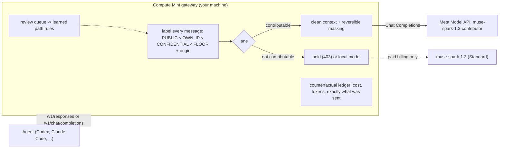

# Compute Mint

**Turn agent usage into compute — compliantly.**

Meta's Muse Spark *Contributor* tier serves the same model at a steep discount (input $0.10 vs $1.25, cached input $0.002 vs $0.15, output $0.20 vs $4.25 per 1M tokens) in exchange for permission to train on the traffic. The Model API Terms forbid sending sensitive, confidential or personal information to Contributor services, and any earlier content that is carried into a Contributor request becomes Contributor content.

Real agent sessions leak secrets and personal data into their context early and carry that context forward. In our own analysis of 683 local Claude Code and Codex sessions, only **8.8%** of agent tokens could have been sent to Contributor under a naive "switch the model mid-session" approach. That is true even though, for this token mix (≈98% cached reads), the discount works out to about **42×**.

Compute Mint is a gateway between agents and models. It:

- **tracks taint** across the context of a multi-step agent (information-flow labels);
- **partitions work into lanes**: public work goes to Contributor in a freshly assembled clean context, confidential work goes to Standard or self-hosted Muse Glimmer;
- **masks and pseudonymizes** (including code-aware renaming that keeps code runnable) so more steps can be contributed;
- **keeps a counterfactual ledger**: what you would have paid, what you paid, and exactly what left your machine;
- **learns from your approvals**, so the share of contributable work grows the more you use it.

> Status: built during the Meta Global AI Developer Hackathon (Oct 26 – Nov 4, 2026). See [docs/BUILD_LOG.md](docs/BUILD_LOG.md) for what was created during the event.

## Layout

| Path | What |
|---|---|
| `gateway/` | OpenAI-compatible proxy: taint tracking, lanes, transforms, routing, ledger |
| `dashboard/` | Savings/exposure dashboard and the privacy–savings dial |
| `bench/` | Acceptance task set and evaluation harness |
| `docs/` | Plan, architecture, build log |

## Three-minute start

Point any OpenAI-compatible agent at the gateway; that one line is the whole integration:

```toml
# Codex config.toml (the gateway holds the Meta key; the client key can be any non-empty string)
[model_providers.compute-mint]
base_url = "http://127.0.0.1:8787/v1"
wire_api = "responses"
```

To watch it work end to end (real Codex, real Meta API, one command each):

```bash
cd gateway && python -m venv .venv && .venv/Scripts/python -m pip install -r requirements.txt   # bin/ on macOS/Linux
cd ../dashboard && npm install && npm run build
echo "META_API_KEY=..." > ../.env                          # gitignored; the script reads it without printing it
python scripts/demo_live.py setup                          # clones D1349375/quant-strategy-dev-skill to ~/Desktop/cm-demo
python scripts/demo_live.py run --out ../demo-out          # gateway + dashboard + 5 Codex tasks + headless recording
```

`run` starts a gateway on a fresh ledger (port 8787, `CM_BILLING=credits`, real Meta API) and the dashboard (port 3000),
runs five `codex exec` tasks in a throwaway `CODEX_HOME` with the `workspace-write` sandbox, records the dashboard
headless with Playwright, and clicks the review approvals itself. It needs the Codex CLI, Playwright with Chromium, and
about nine minutes. It writes logs, screenshots, recordings and `results.json` (including a scan of every Contributor
request body for six planted fake values) under `--out`. The clone lives outside this repository; Codex changes only
that local copy and its push URL is disabled. What is staged is listed in the script's docstring: a planted bug, a
`config/.env` of **fake** credentials, and a draft note with a fictional contact. The prompts, the order of tasks and
the approvals are scripted; what the model says and does is not.

## Architecture



The agent speaks Responses or Chat Completions to the gateway; the gateway always speaks Chat Completions upstream, so
one mask-and-restore path serves every client. Details per module are in [gateway/README.md](gateway/README.md).

## Threat model

What is protected: credentials, personal data, third-party or confidential content, and anything written by a model
whose terms forbid training a competitor (Claude, GPT, unknown models), from reaching Meta's Contributor tier, which
may train on what it receives. The decision is made per message, before the request leaves the machine, and recorded.

| Failure the design is built for | Mechanism |
|---|---|
| A secret or personal value enters the context early and is carried into later requests | Deterministic detectors mask it with a session-consistent placeholder; the client gets the real value back |
| A credential file is read | File-name rules (`.env`, keys, `auth.json`, ...) are FLOOR: no dial and no review decision can lift it; the request is held |
| A file nobody has judged | No rule means CONFIDENTIAL until reviewed; the path joins the review queue |
| Tool output that names no file (a test run, a directory listing) | Paths printed in it, and content fingerprints of sensitive text read earlier, label it |
| Agent history written by another vendor's model | Origin tracking: such content never goes to Contributor |
| Server-side state (`previous_response_id`, stored conversations) deciding what a Contributor request holds | Refused (400); the gateway sends the whole input every time |

Not in scope: a malicious or compromised gateway host, a malicious upstream, content that is sensitive only in meaning
(no semantic judge ships here), and anything that never passes through the gateway.

## Limitations (what is not done, or was seen to go wrong)

- **Detectors are regular expressions.** Phone numbers: only Taiwanese mobile numbers (`09xx` and `+886 9xx`). The live run found that `+886 912 345 678` was *not* masked until this was fixed; other countries' formats are still not detected.
- **Chinese, Japanese and Korean**: only name-shaped terms are fingerprinted; two-character names and ordinary-looking confidential fields are not protected. No claim of full protection for Chinese content is made.
- **Conservative holds are visible.** A recursive directory listing (`Get-ChildItem -Recurse`) that prints a credential file's path is held as credential content (run-03); PowerShell error text with shortened paths put junk paths into the review queue; the fingerprint index trips on ordinary words if a credential file shares vocabulary with the project (run-01 in `docs/BUILD_LOG.md`).
- **On `credits` billing the dashboard's cumulative `e` stays at 100%** after the first Contributor request, because held requests carry no tokens. The mechanism shows in the lanes (held, then Contributor after a review), not in that curve.
- **The confidential channel is not exercised live.** No hosted open-weights endpoint was available; `held` is what runs, and `local` was only tested on mocks.
- **One live session.** The real Codex run is a single 5-task session on one small public repository, one model version, Windows only; Muse Spark's polling of a long-running command failed in Codex (float arguments where integers are required), so the live tasks are short. Task 4 of the final run did not finish (the model's patch did not apply).
- Costs are computed from the `usage` the API returned and the list prices, not from an invoice. The bench ran on `paid` billing because all data was invented; the live run used `credits`, the default.

## Compliance floor

Regardless of any user setting, Compute Mint never routes personal information (including the user's own), credentials, third-party confidential data or regulated data to Contributor services. Users may only choose how much of **their own, publishable** content to contribute.

Standard is private only when the account pays. Use paid with promotional credits (hackathon credits included) counts as non-paid under the Terms (§13.3), and every non-paid request may be used for training (§6), on Standard models too. So by default (`CM_BILLING=credits`) whatever may not go to Contributor stays on this machine: it runs on a local model if one is configured and is held back otherwise. All live runs during the hackathon use credits and invented data only.

## Which numbers are real

| Numbers | Source |
|---|---|
| 8.8% of agent tokens contributable under a naive switch, about 42x discount | Analysis of the author's own 683 local sessions (aggregates only); list prices |
| Every figure in `bench/sample_results/` (e, acceptance, compute multiplier, canary violations, learning curve) | **Mock upstream**: a scripted model, character-based token estimates, a simulated prefix cache. Reproducible offline, byte for byte |
| Smoke test of the gateway, and the Contributor-vs-Standard run below | **Real Meta Model API** (`muse-spark-1.3`, `muse-spark-1.3-contributor`), invented bench data only. Costs are computed from the `usage` the API returned and the list prices, not read from an invoice |
| Live Codex run (`scripts/demo_live.py`, final run `run-05`, 2026-11-04) | **Real Codex CLI 0.166 + real Meta Model API** on `credits` billing: 59 model calls, 29 to Contributor, 30 held, 0 of 6 planted fake values in any Contributor request body. Spend $0.0059; the same tokens at Standard list prices would be $0.1189 (a price-table counterfactual of a short, 86% cached session, not a benchmark result) |

Real Contributor-vs-Standard run (2026-11-04, 15 tasks of the public bench repository, 3 repetitions, same agent loop through the gateway; details in `docs/BUILD_LOG.md`): all Standard 42/45 tasks accepted for $1.14; Contributor where the gateway allows it 44/45 for $0.46, **2.5x** cheaper over all 45 sessions, and **14.6x** cheaper on the 33 sessions that stayed entirely on Contributor (33/33 accepted). The accepted-task difference (44 vs 42) is within what repeated runs of the same model vary by and says nothing about Contributor being better. Known limits: 15 tasks (3 with Chinese prompts), one repository, one model version; the 12 sessions that touched resumed foreign-model context or an unannounced draft went partly to Standard, which on `credits` billing would have been held or run on a local model.

## License

TBD
