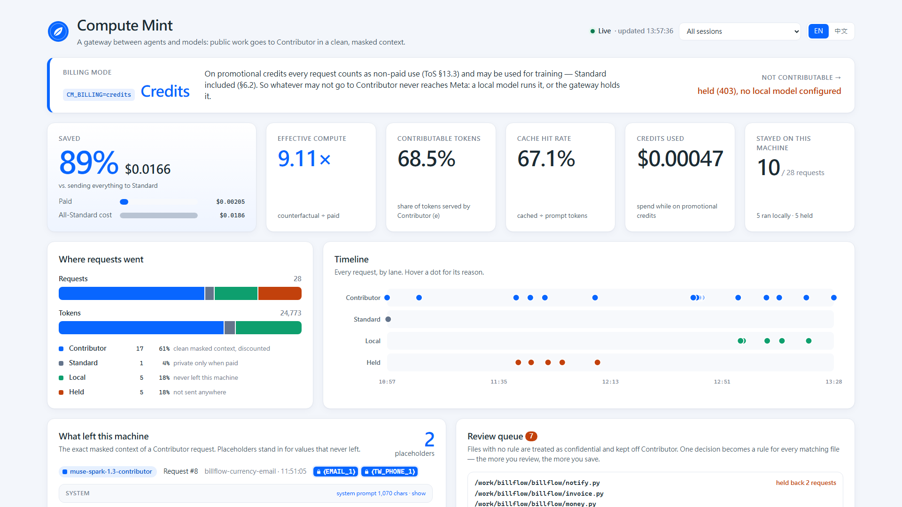

# dashboard

The Compute Mint dashboard (Next.js): billing mode, savings against an all-Standard counterfactual, where each request
went and why, the exact masked context that left the machine, the review queue, and the bench evidence.



It reads the gateway through a same-origin proxy (`app/api/gw/[...path]`) that forwards only the read-only views and
the review decision, and it reads `bench/sample_results/reference-run/results.json` on the server. It calls no model.

## Run the demo (no API key, no network)

Three terminals from the repository root. The gateway venv is built as in `gateway/README.md`.

```bash
# 1. demo data: synthetic sessions through the real gateway on a mock upstream -> dashboard/demo-data/*.db
cd gateway && .venv/Scripts/python -m demo.seed
```

```bash
# 2. the gateway on that data (Windows PowerShell: set the variables with $env:NAME="..." first)
cd gateway && LEDGER_PATH=../dashboard/demo-data/ledger.db POLICY_PATH=../dashboard/demo-data/policy.db CM_BILLING=credits .venv/Scripts/python -m uvicorn compute_mint.app:app --port 8787
```

```bash
# 3. the dashboard on http://localhost:3000 (add ?lang=zh for Traditional Chinese)
cd dashboard && npm install && npm run build && npm run start
```

`npm run dev` works too. `GATEWAY_URL` (default `http://127.0.0.1:8787`) points the dashboard at another gateway;
`BENCH_RESULTS` at another bench run. Stop the gateway before re-seeding: the seed replaces the two `.db` files.

### What the seed contains

`gateway/demo/seed.py` drives scripted agent sessions over the invented repositories in `bench/materials/` (slugkit,
public; billflow, a fictional company's invoicing service) through `create_app` with an `httpx.MockTransport` as the
model. No real session content is used. Timestamps are spread over the last three hours. Three phases make every lane
appear:

| Phase | Billing | Non-contributable requests go to |
|---|---|---|
| 1. comparison | `paid` | Standard (the only Standard rows; marked `paid` in the table) |
| 2. | `credits`, no local model | held (403) |
| 3. | `credits`, local model | local |

It includes a pasted API key, a customer e-mail and a phone number (masked as `⟨API_KEY_1⟩`, `⟨EMAIL_1⟩`,
`⟨TW_PHONE_1⟩`), a `.env` read (held), a session resumed from another vendor's model (held by origin), test output that
names an unreviewed file (held, `[output-path]`), and customer names in test output (local). Between phases 2 and 3 two
review decisions are made (slugkit's code and tests are public), so the slug task held in phase 2 is contributed in
phase 3. Seven paths stay in the review queue. The seed checks that no planted canary value reached a Contributor
request and that on credits only Contributor requests reached the mock Meta host.

### The review demo

1. In **Review queue**, press **Public** on `/work/slugkit/docs/**`. The gateway turns the decision into a rule.
2. Resend the sessions behind the queued paths:

   ```bash
   cd gateway && .venv/Scripts/python -m demo.seed --replay
   ```

   The docs session now goes to Contributor; `billflow/shared/**`, still unreviewed, is held. The page picks up the
   new rows within four seconds.

## Sections

| Section | Source |
|---|---|
| Billing mode | `GET /v1/status`: `credits` or `paid`, and where non-contributable requests go |
| Saved, compute ×, e, cache hit, credits used, stayed local | `GET /v1/ledger/summary` (`?session=` with the session filter) |
| Where requests went, timeline, requests table | `GET /v1/ledger/requests` (newest 500 rows) |
| What left this machine | `GET /v1/ledger/requests/{id}`: `sent_payload` of a Contributor request, placeholders highlighted. Defaults to the newest one with masked values; click a Contributor row or dot to show another |
| Review queue | `GET /v1/review`, `POST /v1/review/{id}`. Paths that share a suggested pattern are shown together, because one decision settles all of them |
| Bench evidence | `summaries` of the bench reference run: acceptance, e, compute multiplier, canary violations |

Numbers are the gateway's own definitions: a local request costs nothing and counts its Standard price as the
counterfactual; a held request has neither. Amounts in the demo are cents because the sessions are short.

## Design

Blue and white, system fonts (Inter if installed). The brand is Compute Mint with its own coin-and-leaf mark; no
provider logo or trademark is used. Lane colors were checked with a color-vision-deficiency palette validator
(contributor blue, local green, held orange pass all pairs; Standard is a deliberate neutral gray), and every lane is
also labeled in text. Built for a 1920×1080 recording; works down to phone width.

Screenshots: `docs/screenshots/` (01 overview at 1920×1080, 02 full page, 03 full page in Traditional Chinese,
04 phone width, 05 after a review decision and `--replay`).

```bash
npm run lint
npm run build
```
